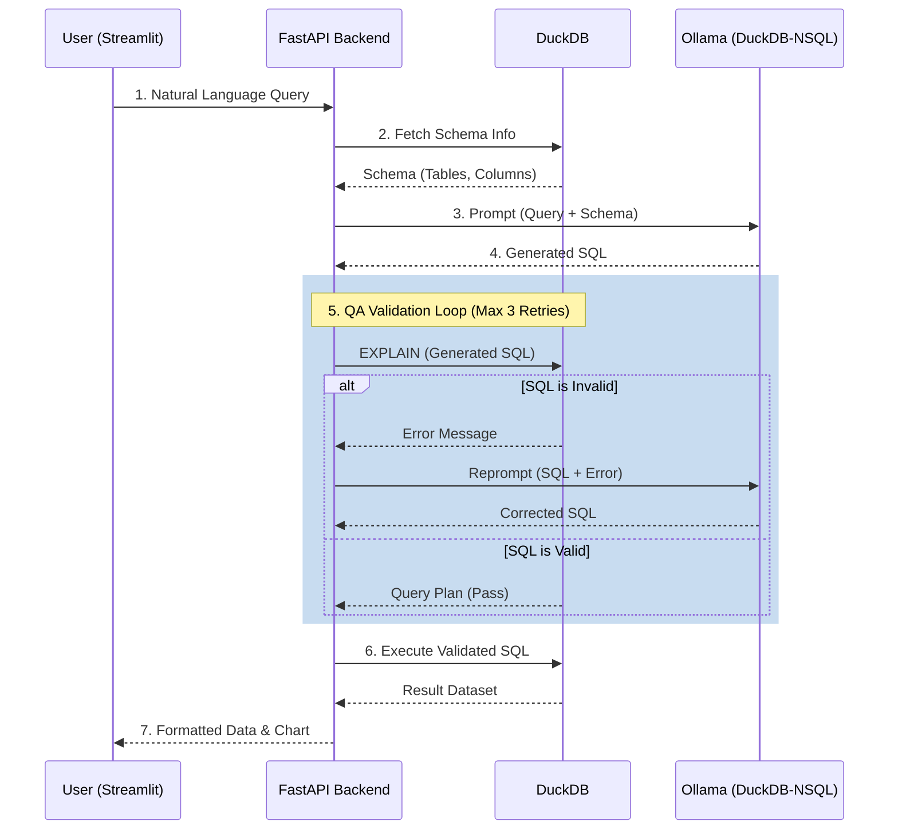

# Architecture: Text-to-SQL Analytics Assistant

## 1. Project Overview

This project is a localized, privacy-first data querying tool designed for Data and QA Analysts. It allows users to query databases using natural language, validating and executing the generated SQL to return data tables and visualizations. 

By leveraging a local Large Language Model (LLM) tailored for SQL generation, the system ensures zero data leakage while maintaining high query accuracy through a robust self-correcting validation loop.

## 2. Technology Stack

* **Frontend:** Streamlit (Provides the chat UI, data tables, and Plotly/Altair charts).
* **Backend:** FastAPI (Acts as the orchestration layer and REST API).
* **Database Engine:** DuckDB (High-performance, in-memory/local analytical SQL engine).
* **LLM Engine:** Ollama (Running locally).
* **Model:** `duckdb-nsql:7b` (A 7B parameter model specifically fine-tuned on DuckDB syntax).
* **Validation:** Custom DuckDB execution sandbox (utilizing `EXPLAIN` or dry-runs) + string parsing for DML blocking.

## 3. System Architecture

The following diagram illustrates the flow of data between the system components.



## 4. Step-by-Step Data Flow

1. **User Input:** The user submits a plain English question via the Streamlit chat interface.
2. **Context Gathering:** The FastAPI backend extracts the current database schema from DuckDB (table definitions, column names, and data types).
3. **Prompt Construction:** The natural language query and the schema are formatted into a strict prompt template designed for the `duckdb-nsql` model.
4. **LLM Generation:** Ollama processes the prompt and returns a raw SQL string.
5. **SQL Validation & QA Loop:**
   * **Security Check:** The backend scans the SQL for prohibited DML commands (`DROP`, `DELETE`, `INSERT`, `UPDATE`).
   * **Syntax/Schema Check:** The backend runs the query against DuckDB using the `EXPLAIN` command (or a `LIMIT 0` wrapper). 
   * **Self-Correction:** If DuckDB throws an error (e.g., column not found, syntax error), the error message and the bad SQL are sent back to the LLM with instructions to fix it. This loop repeats up to a maximum of 3 times.
6. **Execution:** Once the SQL passes validation, it is executed against DuckDB.
7. **Presentation:** The resulting dataset (e.g., a Pandas DataFrame) is sent to Streamlit, which renders the raw data and generates an appropriate visualization based on the data shape.

## 5. Hardware & Setup Requirements

* **Memory:** Minimum 16GB RAM recommended. The `duckdb-nsql:7b` model will consume approximately 4.5GB - 6GB of RAM via Ollama's 4-bit quantization, leaving ample memory for DuckDB operations and the Python stack.
* **Prerequisites:**
  * Python 3.10+
  * [Ollama](https://ollama.com/) installed locally.
  * Model pulled via CLI: `ollama run duckdb-nsql`

## 6. Repository Structure (Proposed)

```text
├── frontend/
│   └── app.py              # Streamlit application
├── backend/
│   ├── main.py             # FastAPI application setup
│   ├── llm_service.py      # Ollama integration and prompt templates
│   ├── db_service.py       # DuckDB connection and schema retrieval
│   └── validator.py        # QA loop and SQL execution sandbox
├── data/                   # Sample datasets (.csv, .parquet)
├── requirements.txt
└── README.md
```
